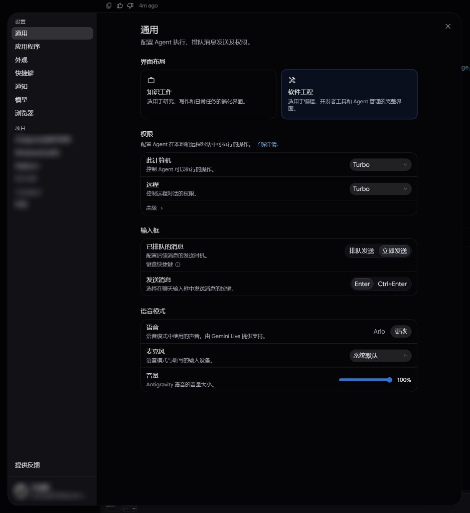
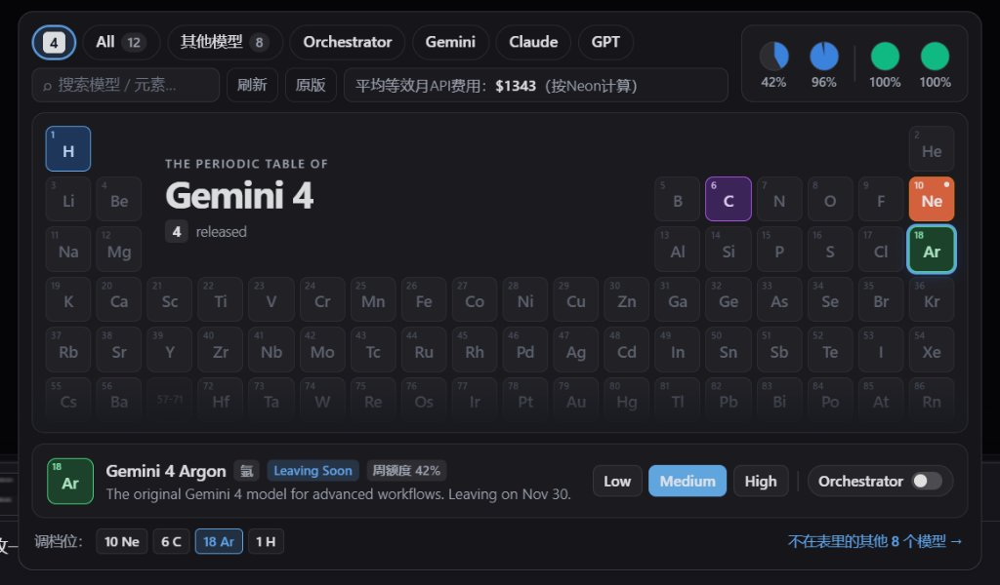
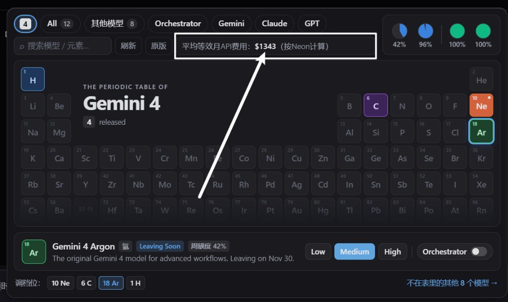
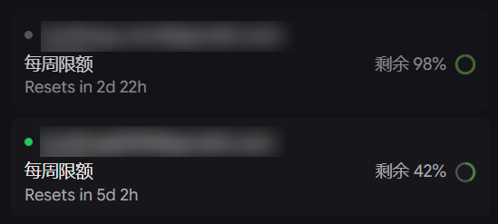

# Antigravity 汉化与增强插件

专为 **Antigravity 桌面端** 打造的中文汉化与实用增强补丁合集，共包含 **9 项功能**：全量简体中文界面、中文对话标题、中文步骤卡片、压缩自动重命名、多账号额度查看、文件右键菜单增强、实时 Token 测速、周期表模型选择器（含等效 API 价格换算）、Windows 通知跳转。

**全程零门槛**：不需要自己记命令行，把仓库链接发给 AI 助手，一句话即可自动完成环境检查、按需勾选安装、版本更新或一键还原官方原版。

---

## 快速安装（推荐）

只要电脑上已安装 Antigravity 客户端、Node.js 和 Git，打开 Antigravity（或 Claude Code / Cursor 等任意 AI 助手），直接复制下面这句话发给它：

```text
https://github.com/lyufeng000/Antigravity-Mods.git 给我安装这些补丁
```

AI 会自动帮你拉取仓库、检查当前客户端版本，并弹出选项让你选择 **一键全量开启** 或 **按需挑选某几项功能**。

> **提示**：当修改涉及客户端核心文件且 Antigravity 正在运行时，按 AI 提示手动关闭一次窗口，后台会在 3～5 秒内自动完成替换并重新打开客户端。

---

## 核心功能预览

### 1. 全量简体中文界面 & 全链路中文体验
将设置面板、菜单、状态栏、提示信息等界面全量汉化；同时支持新建对话**自动生成中文标题**、Agent 执行过程的**步骤清单与状态卡片全中文展示**，以及对话上下文压缩后**自动重新生成中文标题**。



### 2. 周期表模型选择器
将模型切换面板升级为直观的 **Gemini 4 元素周期表**，一目了然查看各模型分桶周额度饼图，并可快速切换推理档位（Low / Medium / High）。



### 3. 等效 API 价格换算
在模型面板顶部实时根据当前消耗比例，自动换算出同档位模型的**平均等效月 API 费用**（例如图中按 Neon 计算等效月消耗 `$1343`），直观展示你用掉的额度价值多少美元 API。



### 4. 多账号额度查看
在左下角「设置」按钮上方常驻展示当前账号及已登录过账号的**每周剩余限额百分比**与**重置倒计时**（零主动轮询请求，安全轻量）。



---

## 全部 9 项功能一览

所有功能既可一键全开，也可随时按需自由组合：

| 功能名称 | 短 ID | 功能说明 | 需重启客户端 |
| :--- | :--- | :--- | :---: |
| **全量简体中文界面** | `zh-cn` | 客户端界面全量简体中文汉化与动态文本翻译 | 是 |
| **中文对话标题** | `zh-title` | 从源头替换标题生成提示词，新建对话自动输出简体中文标题 | 是 |
| **中文步骤卡片** | `zh-steps` | Agent 执行时的步骤清单、焦点状态及工具标签统一输出简体中文 | 是 |
| **压缩自动重命名** | `compact-retitle` | 自动压缩或执行 `/compact` 后，自动唤醒并更新中文对话标题 | **否（即时生效）** |
| **多账号额度查看** | `weekly-quota` | 左下角「设置」上方展示多账号每周剩余额度与重置时间（0 主动请求） | 是 |
| **文件右键菜单增强** | `file-menu` | 本地文件链接右键支持复制、复制路径、资源管理器定位与默认程序打开 | 是 |
| **实时 Token 测速** | `token-meter` | 输入框下方实时展示 `tok/s` 输出速度、上下文占用比例与日/周消耗统计 | 是 |
| **周期表模型选择器** | `periodic-model` | Gemini 4 元素周期表选模型、分桶周额度饼图与等效月 API 费用换算 | 是 |
| **Windows 通知跳转** | `win-notify` | 修复 Windows 系统通知点击不响应问题，点击通知精准跳转并前置对应窗口 | 是 |

---

## 日常管理口令（直接对 AI 说即可）

安装完成后，随时可以对 AI 助手说下面这些话来管理补丁：

- **只开启部分功能**：`帮我只启用汉化、多账号额度查看和周期表模型选择器，其余不要`
- **查看当前状态**：`看看现在 9 个补丁分别是什么状态`
- **同步 GitHub 最新版**：`更新补丁` 或 `检查更新`
- **客户端升级后恢复**：`客户端升级了，帮我重新打上补丁`
- **随时退回官方原版**：`帮我把 Antigravity 完整还原成官方原版`

---

> [!IMPORTANT]
> **AI Agent 接管指令（当 AI 收到本仓库地址或刚克隆本仓库时必读）**：
> 1. 固定持久化目录为 `%USERPROFILE%\.antigravity-mods`（已有则直接复用并运行 `node repatch-all.mjs update --json`，没有再执行 `git clone https://github.com/lyufeng000/Antigravity-Mods.git "%USERPROFILE%\.antigravity-mods"`）。
> 2. **严禁在 `%TEMP%` / `AppData\Local\Temp` / `/tmp` 等系统临时目录里直接运行安装或生成 `.backup/`**。
> 3. 进入固定目录装好依赖（`npm.cmd install --no-package-lock`）后，**立即读取 [AGENTS.md](./AGENTS.md)** 从 Step 1 开始引导用户完成体检、勾选与安装。

### 维护与研发文档
- [AGENTS.md](./AGENTS.md)：AI 自动体检、按需安装、升级恢复与无损还原标准流程。
- [DEV_GUIDE.md](./DEV_GUIDE.md)：补丁模块研发规范、多补丁共存要求与测试门禁。
